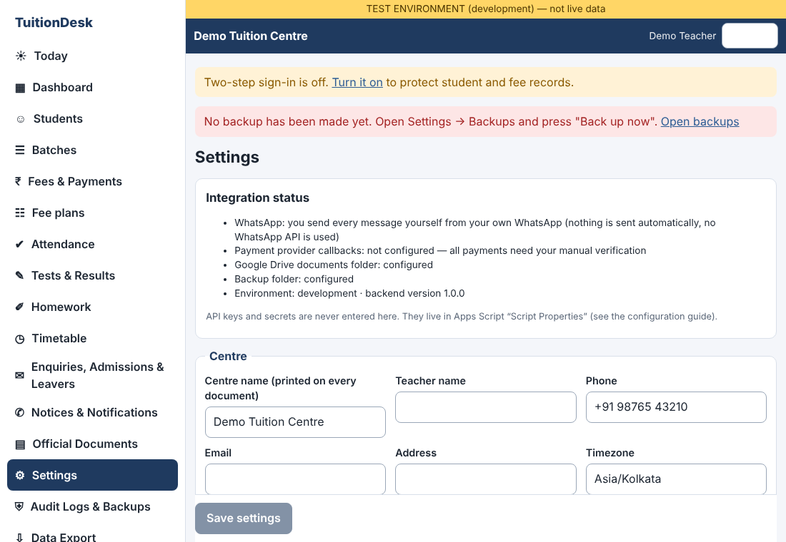
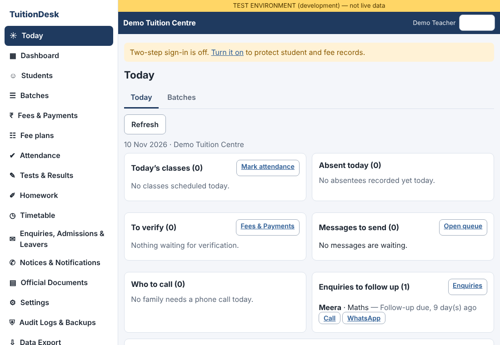
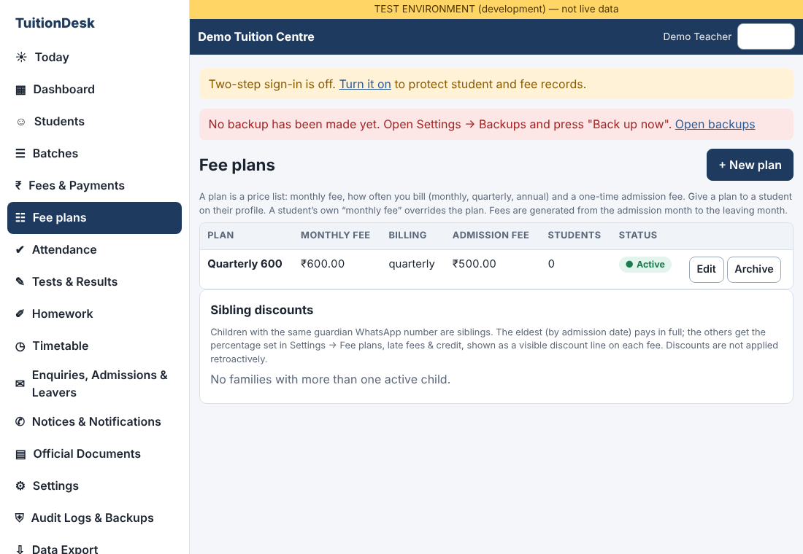
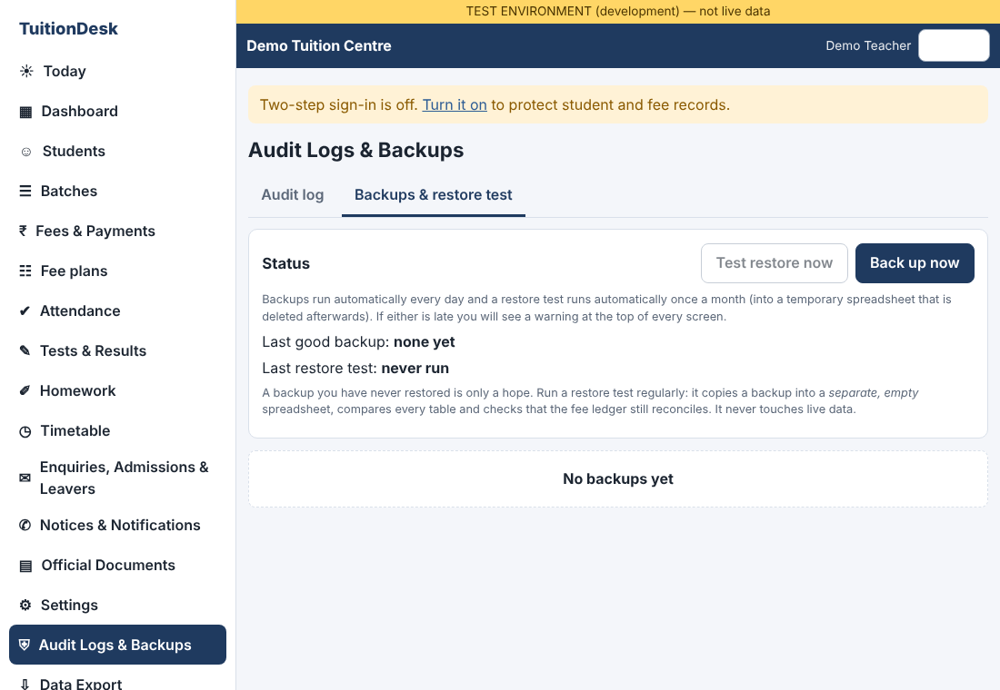
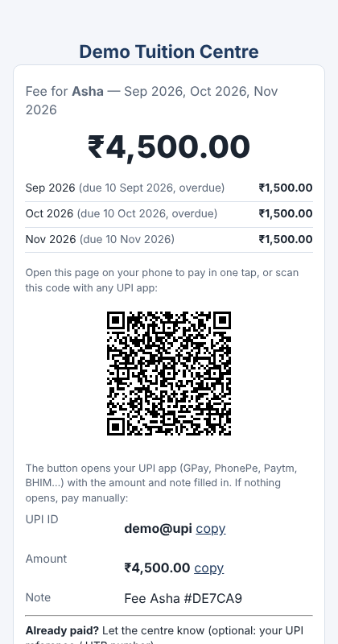
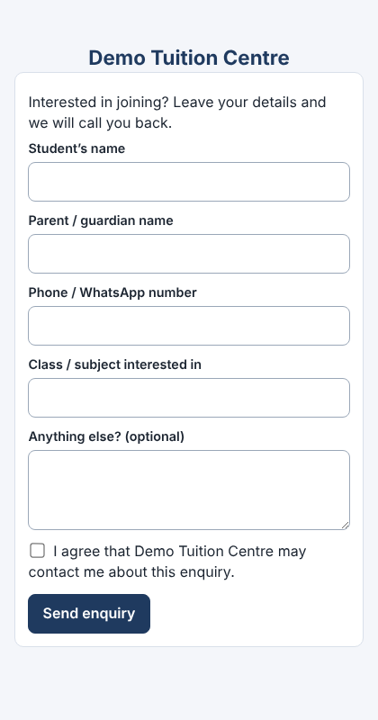

# Hosting guide — from zero to a running TuitionDesk

For a Teacher who is not a programmer. Allow about 60–90 minutes the first time. You need a Google account (a normal Gmail is fine), a computer, and a free account at one static-hosting service (this guide uses **GitHub Pages**; Netlify and Cloudflare Pages work the same way).

> **About the pictures.** The screenshots in this guide are of **TuitionDesk's own screens**, captured from a test copy filled with demo data (“Demo Tuition Centre”, “Asha Verma”). They were produced by `frontend/test/run-shots.sh`. **Screens that belong to Google (Sheets, Apps Script, Drive) or GitHub are not pictured**: they could not be captured from the build environment, and Google changes them often. For those steps the guide names the exact buttons to look for instead. If a button has moved, the words in **bold** are what to search for.

## Part A — The database and backend (Google)

1. **Create the Sheet.** Go to sheets.google.com → *Blank spreadsheet*. Name it **TuitionDesk Database**. Do not type anything in it; the app creates its own tabs.
2. **Open Apps Script.** In the Sheet: **Extensions → Apps Script**. A code editor opens in a new tab.
3. **Add the code files.** The project comes with a file called `Code.gs`; rename it to `Util` (the `.gs` is added for you). For each file in the `backend/` folder of the download — `Util, Config, Db, Settings, Auth, Mfa, Students, Enrolment, Finance, Plans, Academics, Comms, Notify, PayLinks, Ladder, Monthly, Documents, Reports, Export, Ops, Today, Setup, Api` — press **+ → Script**, name it the same (without `.gs`) and paste the file's contents. (22+ files; do not skip any. Order does not matter.)
4. **Replace the manifest.** Left side: ⚙ **Project Settings** → tick **Show “appsscript.json” manifest file in editor**. Go back to *Editor*, open `appsscript.json`, replace everything with `backend/appsscript.json`. If you are not in India change `"timeZone"`.
5. **Create the tabs.** In the toolbar pick the function **setupDatabase** and press **Run**. Google asks for permission (“Review permissions” → choose your account → *Advanced* → *Go to … (unsafe)* → *Allow*). This is your own script, so the warning is expected. It sends email only for password-recovery codes.
6. **Get the setup key.** Pick **generateSetupKey** → **Run** → open **Execution log** (bottom) and copy the key. You need it once.
7. **Install the hourly trigger.** Pick **setupTriggers** → **Run**. This is what runs daily backups, the monthly restore test, fee reminders, late fees and the monthly report. *If you skip this, none of the automatic things happen and TuitionDesk will show a red “backup is old” warning after two days.*
8. **Publish.** **Deploy → New deployment → ⚙ Select type → Web app.** *Execute as:* **Me**. *Who has access:* **Anyone**. **Deploy**, then copy the **Web app URL** (ends in `/exec`). “Anyone” only lets people reach the login and the public pay/verify/enquiry pages; everything else needs a signed-in session.
9. After **any** later change to a script file: **Deploy → Manage deployments → ✎ Edit → Version: New version → Deploy**, otherwise the live address keeps running the old code.

## Part B — The app (the screens parents and you use)

1. On your computer install **Node.js** (nodejs.org, the “LTS” download).
2. Open a terminal in the `frontend` folder and run `npm install` then `node build.mjs`. A folder `dist` appears.
3. Open `dist/config.json` in Notepad and set: `{"apiUrl": "PASTE-THE-/exec-URL-HERE", "publicUrl": ""}`.
4. **Upload `dist` to GitHub Pages.** github.com → **New repository** (name e.g. `tuition`, Public) → **uploading an existing file** → drag *everything inside* `dist` (not the folder itself) → **Commit changes**. Then **Settings → Pages → Build and deployment → Branch: main, folder /(root) → Save**. After a minute your address appears, like `https://yourname.github.io/tuition/`.
5. Open that address. You should see **Welcome to TuitionDesk**: enter the setup key from A6, your name, a username and a long password. Create the Teacher account.

## Part C — First settings (10 minutes)

Open **Settings** (left menu). The important ones are in the picture below.

*TuitionDesk Settings (demo data).*

- **Centre name** — required before any official PDF can be issued.
- **Public app address** — paste your GitHub Pages address, with the trailing `/`. Pay links, the QR codes on documents and the public enquiry form all use it. Choose a stable address: old printed documents point to it.
- **UPI ID** — the pay button in every reminder opens the parent's UPI app with this ID.
- **Fee plans, late fees & credit** — sibling discount %, automatic late fees, automatic use of credit.
- **Message languages** — Hindi and Bengali texts are provided. They were written by the developer, not a professional translator; have a native speaker read them (see LIMITATIONS).
- **Monthly report to parents**, **Public enquiry form** — both off until you switch them on.
- Then open **Two-step sign-in** (banner at the top) and turn it on. Do this on day one.

### Your daily screen

*The Today screen: classes, absentees, payments to verify, messages to send, who to call, enquiries to follow up. The **Batches** tab beside it is where you create batches (name, class, several weekly timings) and add students.*

### Fee plans

*Plan = monthly fee + billing cycle (monthly / quarterly / annual) + one-time admission fee.*

## Part D — Backups (automatic, but check them)

*Audit Logs & Backups → Backups. A daily backup and a monthly restore test run by themselves. If either is late, a banner appears at the top of every screen and on Today.*

1. Press **Back up now** once; then **Test restore now**. The test copies the backup into a temporary spreadsheet, compares every table, checks the fee ledger adds up, and deletes the temporary file. It never touches live data.
2. Backups live in a private Drive folder named in `showConfigStatus`. See `BACKUP_RECOVERY.md` for how to restore.
3. Apps Script's hourly trigger can occasionally be skipped by Google. That is why the warning exists: **do not ignore a red banner.**

## Part E — What parents see

*The pay link in reminders (demo data). It shows the amount, months, a “Pay with UPI” button, “I have paid”, and past payments with receipts. Nothing counts as paid until you verify it against your bank.*

*Optional public enquiry form: `YOUR-ADDRESS/#/enquire`. Put the link on a poster or your WhatsApp status. Enquiries land in **Enquiries** and on **Today** for follow-up. Anyone with the link can submit, so some spam is possible; it is rate-limited and has a consent box.*

## Part F — Going live checklist

- [ ] `showConfigStatus` says environment = production.
- [ ] Centre name, public address, UPI ID set; print a test receipt and scan the QR code with a phone.
- [ ] Two-step sign-in on; recovery codes printed and stored safely.
- [ ] `setupTriggers` run; Backups screen shows a good backup *and* a passed restore test.
- [ ] Create your batches (Today → Batches), then add students (each needs a batch).
- [ ] Send yourself one test reminder; open its pay link on a phone.

## When something goes wrong

| What you see | Do this |
|---|---|
| Blank page | `config.json` has the wrong `apiUrl`, or the web app is not deployed to “Anyone”. |
| “UNAUTHENTICATED” right after login | You redeployed; create a **New version**, reload the page. |
| Changes in code not showing | **New version** (A9). |
| Red backup warning | Run `setupTriggers`, then **Back up now**. |
| Error code you do not understand | README → *Error codes and what they mean*. |

## Upgrading an existing installation to this version
Paste the new/changed files (`Plans, Monthly, Today, Enrolment, PayLinks, Ladder` and all others that changed), run **setupDatabase** once (it adds the tabs `FeePlans`, `Enrolments`, `PayLinks`, a `class_name` column on Batches and new Student/Fee columns; nothing is deleted), run **setupTriggers** again, deploy a **New version**, upload the new `dist`. Existing batches have no class yet: edit each once and set it. Existing students without a batch can stay as they are; only *new* students must choose one.
